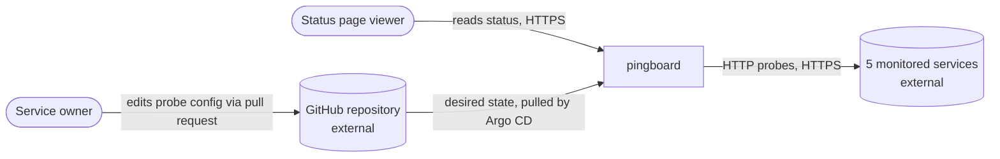
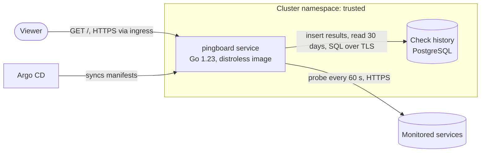

# pingboard: design record

Dry run of design-phase, 2026-11-18. Input: `evals/standards-baseline/dryrun-pingboard-project-file.md`, with its six Proposed decisions taken as accepted at their defaults and DOD-1 set to "shows up or down status for 5 services, checked every minute, with 30 days of history" for this fixture.

## Summary

pingboard is one Go HTTP service that probes five services every minute, stores results in PostgreSQL and serves a server-rendered status page. It runs as a Kubernetes Deployment, delivered by Argo CD from the repository's `k8s/` folder. No user accounts: the page is public and read-only; probe targets come from a config file in the repository.

## Decision records

| Record | Title | Status |
| --- | --- | --- |
| [0001](../docs/decisions/0001-single-go-service-with-server-rendered-page.md) | Single Go service with a server-rendered page | proposed |
| [0002](../docs/decisions/0002-store-check-history-in-postgresql.md) | Store check history in PostgreSQL | proposed |
| [0003](../docs/decisions/0003-deliver-with-argo-cd.md) | Deliver with Argo CD from `k8s/` | proposed |

New dependency: the PostgreSQL driver goes to adopt-or-build (see `evals/adopt-or-build/pingboard/`).

## System context

## Containers

Trust boundaries: internet to ingress; pingboard to monitored services; repository to cluster (via Argo CD).

## Threat model

Method: STRIDE.

### 1. What are we working on?

The container diagram above. Data crossing boundaries: page HTML (public), probe requests (no credentials), check results (internal), database credentials (Kubernetes Secret), manifests (from the repository).

### 2. What can go wrong?

| ID | Element or flow | STRIDE | Threat |
| --- | --- | --- | --- |
| T1 | Ingress to web | D | Request flood slows or stops the page |
| T2 | Web to database | I | Database credentials leak through logs or the image |
| T3 | Repository to cluster | T | A malicious change to probe config or manifests reaches production |
| T4 | Web to monitored services | S | A probe target is changed to an internal address (server-side request forgery) |
| T5 | Web | E | A vulnerable dependency gives code execution in the container |
| T6 | Database | R | No record of who changed probe config |
| T7 | Status page | T | Stored check output rendered unescaped (cross-site scripting, CWE-79) |

### 3. What are we going to do about it?

| ID | Response | How |
| --- | --- | --- |
| T1 | Mitigate | Rate limit at the ingress; page served from a 30-second cache (build input) |
| T2 | Mitigate | Credentials only from a Kubernetes Secret; gitleaks in CI (SEC-09, OSPS-BR-07.01) |
| T3 | Mitigate | Branch protection and required review (SEC-03); Argo CD syncs only `main` (DEL-04) |
| T4 | Mitigate | Probe targets validated against an allowlist of public hostnames at load time (build input) |
| T5 | Mitigate | Pinned dependencies and image digests (SUP-03); distroless base; non-root user (build input) |
| T6 | Mitigate | Config lives in git, so history and authors are recorded (OSPS-QA-01.02) |
| T7 | Mitigate | Go `html/template` auto-escaping; never mark probe output as safe HTML (build input) |

No risks accepted.

### 4. Did we do a good enough job?

Not examined: the Kubernetes cluster itself and Argo CD's own security (owned by the platform team); availability of the monitored services. Revisit when user accounts, a new external system or a second container is added.

## Build inputs

- Components: probe scheduler, result store, page renderer, config loader with hostname allowlist.
- Mitigations to implement: T1 cache and rate limit, T4 allowlist, T5 non-root user, T7 escaping.
- Rules already in the register cover T2, T3, T5 pinning and T6.

## Open questions

- Which ingress controller the cluster uses, for the rate limit (ask the platform team).
- Decision records 0001 to 0003 wait for acceptance.
