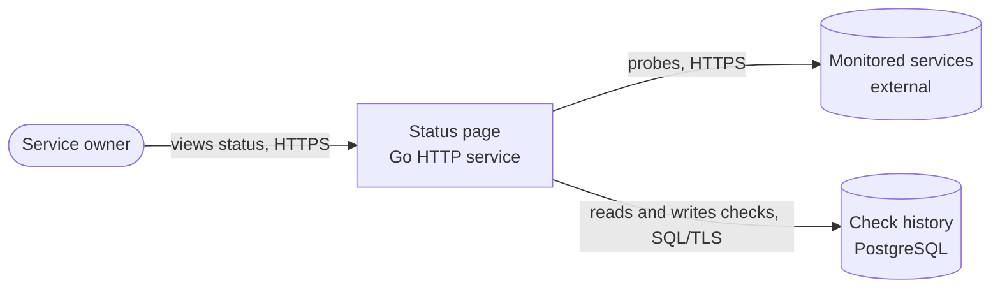

# C4 diagrams

From Simon Brown's C4 model (c4model.com, accessed 2026-11-18). The model has four abstractions (software system, container, component, code) and is notation independent. Design-phase always draws the first two diagrams.

## System context diagram

- One box for the system being designed.
- A box for each kind of person who uses it (role, not name).
- A box for each external system it sends to or receives from. Every interfacing system in the Vision Map appears here.
- A labelled arrow for each relationship, saying what flows and why.

## Container diagram

A container is a separately running or deployed thing: a web app, an API service, a database, a queue, a mobile app, a scheduled job. Not a Docker container necessarily.

- One box per container, with its name, technology and one-line responsibility.
- Arrows for each interaction, labelled with what flows and the protocol (for example "reads and writes rows, SQL/TLS").
- Draw a dashed boundary around the system, and mark trust boundaries (where data crosses from less to more trusted) for the threat model.

## Component diagram (only when needed)

Draw one for a container whose internal parts matter to a decision record or a threat. Skip it otherwise.

## Notation

Draw as text so the diagrams live in version control. Mermaid example:

Checklist for each diagram: a title; a key if shapes or colours carry meaning; every arrow labelled; every element named with its type and technology.
